# Sell Individual Videos

**Monetizing Video Content**

You can publish video content utilizing Ethereum based smart contracts and Coinbase's Layer 2 network, Base, with support for other chains coming soon.

You can sell:

* Open Editions: Unlimited copies available at a set price
* Limited Editions: A limited number of copies available at a set price
* Timed Open Editions: Unlimited copies available for a limited time

**Prepare Your Content:**

* Rad TV supports a wide range of video file types including WEBM, MP4, MOV, MKV, AVI, and MXF.
* Video files must be less than 100GB in size, and max 4K (3840 x 2160) resolution.
* Thumbnails must be 1920x1080 or 16:9 ratio, no larger than 4MB, and JPG, PNG, or JPEG format.

## Getting Started

**In order to sell content onchain you will need a web3 wallet.**

What you'll need:

●  A cryptocurrency wallet that support Ethereum

●  A sheet of paper and a pen

●  About an hour with the room to yourself

## Step 1: Get the MetaMask app

On your device, go to [_metamask.io_](https://metamask.io/). From there, click to get MetaMask from your device’s app store or add the browser extension. The app is free, and doesn’t require signing up or entering any personal information.

## Step 2: Secure your wallet

MetaMask allows you to load a wallet you’ve made before. If you’re new to crypto, choose Create a new wallet.

After choosing a password, grab a pen, a piece of paper, and get the room to yourself. MetaMask will lead you through steps to back up your Secret Recovery Phase (seed phrase). This is very important—you’ll use these twelve words to secure/recover your crypto.

They resemble a nuclear launch code from a Bond film. Here's an example:

## Step 3: Get your Ethereum wallet address

In MetaMask, there's some letters and numbers in a light blue oval:

This is your Ethereum wallet address. Here's an example:

0xbF6857e94af6b3E8BA0534d630DFFBff49f9bd48

Anyone with this wallet address can see the balance of your account, and send tokens and NFTs to you. They cannot withdraw assets. Anyone with your Secret Recovery Phrase (Step 2) has full access to both receive and send assets.

Tap the blue oval to copy your wallet address. Never tell anyone your Secret Recovery Phrase.

## Step 4: Buy ETH with debit, credit, or bank account

Click the buy button in metamask and follow the steps for your region. When you complete your purchase ETH will be transferred to your account.

Now that you have ETH in your wallet you are ready to create Open and Limited Edition Videos onchain!

**Create Your Video**

Visit [https://radtv.com](https://radtv.com) to create your free channel and get started.

Click [here for a step-by-step guide via docs](customizing-your-rad-tv-channel.md) or click [here for a how-to video](https://rad.live/watch/feature/4bb56bbd-59f2-48b6-addb-c6bb32ab0dbe/)!

Go to the [Rad TV Creator Studio](https://rad.live/channel/) to get started

1. Upload a video you want to monetize or click the Monetization button on a piece of existing content

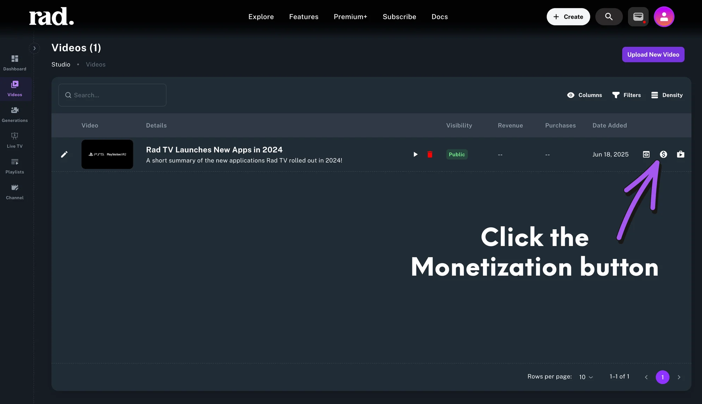

After clicking the Monetization button you will see the Video Edit page pictured below

All videos start off with No Monetization (Free). Clicking the 'Sell Video through Cryptocurrency' button will show the monetization options pictured below.

To get started you will need to connect your web3 wallet. Click the 'Connect Wallet' button and confirm the connection to Rad TV in your wallet.

For this demo we will be using Base and a mobile [Metamask wallet](https://metamask.io/).

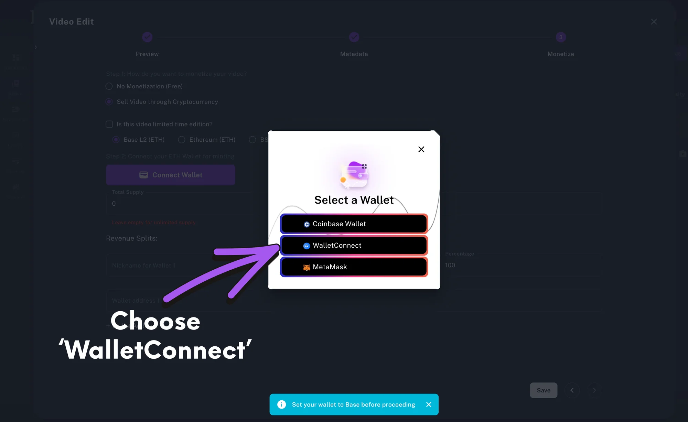

For this demonstration we will be using the 'WalletConnect' protocol that enables easy connections for almost all mobile wallets.

Once you select WalletConnect you will be shown a QR code that looks like this 👇

Now you will need to open your mobile Metamask wallet.

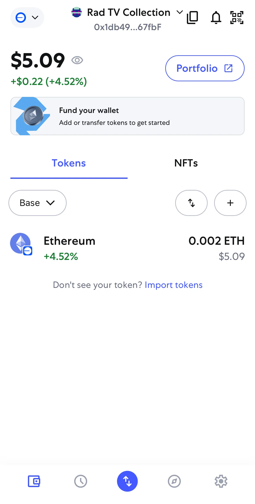

You can see our wallet has $5 worth of ETH on Base or .002 ETH.

Now we will connect our wallet to Rad TV.

Click on the the QR reader button in the top right hand corner of the wallet as pictured below

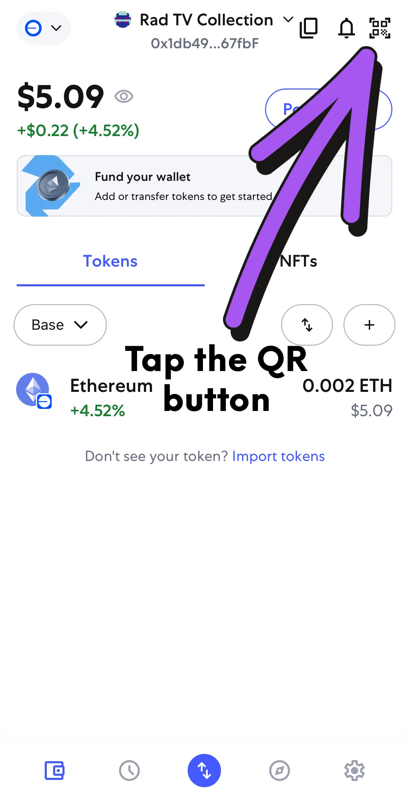

Once you scan the QR code on your screen, you will see a pop up inside your mobile wallet that prompts you to 'Connect' to Rad TV as pictured below 👇

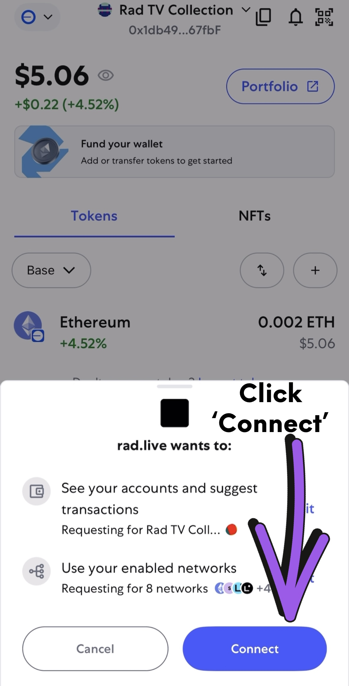

Once you confirm the connection you will see that your permissions have been updated

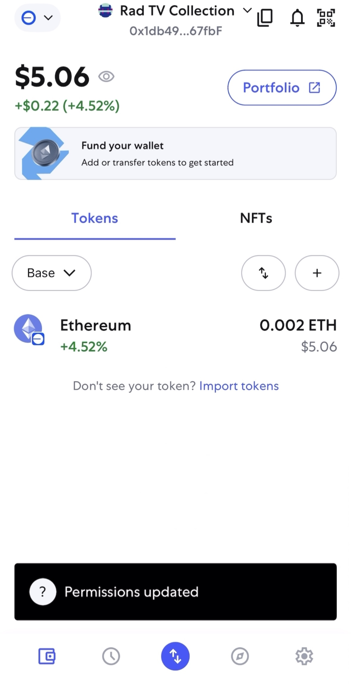

Now that we have connected our web3 wallet, we are ready to deploy a collection contract.

Everything minted onchain needs a collection contract. Once you deploy your collection contract you can add as many items to the collection as you would like.

You can deploy as many contracts as you would like. Each collection contract will have its own name, collection cover image, and associated metadata. These collections will be discoverable across all NFT marketplaces like Opensea or Magic Eden.

You could have 1 contract that holds everything you create or you could deploy a new collection each time and organize your pieces into different baskets/collections.  Let's say you are making a series of pieces that all have a similar style. You most likely would want those pieces to live together inside of the same collection so that they are easily discoverable and the narrative around the pieces is the same.

Let's deploy our first collection contract.

To get started click the dropdown arrow on the right side of the box that says 'Create or Add to your existing Collection' 👇

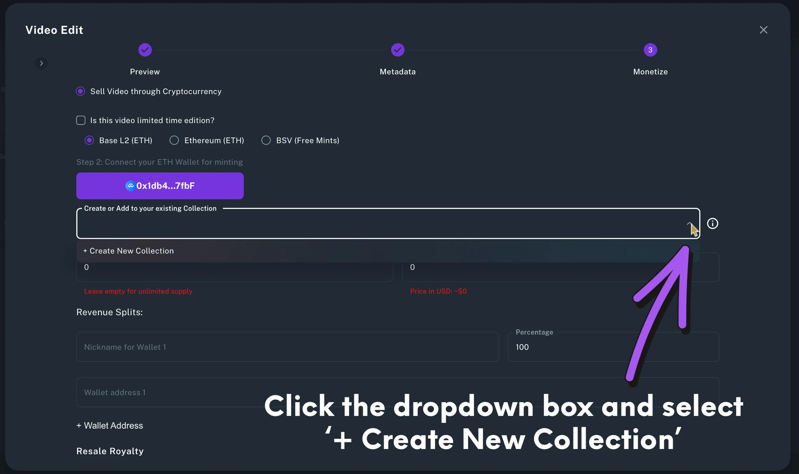

Once selected you will see the Contract Setup and Deploy page as pcitured below

Complete the Collection Name and Collection Description fields and upload a 1920x1080 Collection Cover Photo. This cover photo will be used everywhere your collection is discoverable eg: Opensea and Magic Eden. Make sure this image accurately represents the collection as it cannot be changed.

Whenever you are ready, make sure your mobile wallet is open and click 'Deploy Contract'.

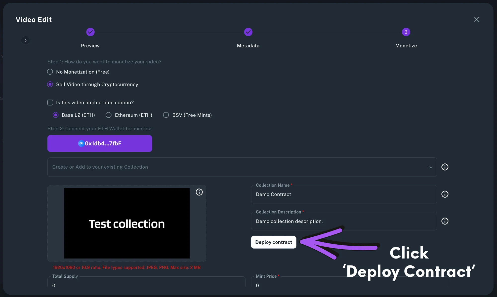

Typically you will see the transaction confirm/reject pop up within a few seconds, but sometimes it can take up to 1 minute. Please be patient as blockchain speeds vary based on many factors.

When the pop up appears, click the 'Confirm' button as pictured below 👇

After you click the confirm button you will see a pop up that says transaction processing, followed by a final pop up that confirms the transaction has been registered on the blockchain.

Great work! You have successfully deployed a contract onchain and are ready to mint and monetize your works through this contract!

Now it's time to mint your work into this contract and make it available for purchase!

After successfully deploying your contract the monetization page should automatically select the new contract. You can always click on the Collection Contract box and select the appropriate contract from the dropdown menu. You must always use the same wallet that deployed the contract in order to access the contract and mint works into it.

Next we will set the supply and the price.

The supply can be limited or open edition (unlimited). To set a total supply cap, simply enter the number of copies you want to be available for purchase or set the total supply to 0 in order to create an open edition (aka unlimited supply).

When setting your price it is important to remember that the USD value of ETH is ever changing and the amount you put in will always fluctuate in USD value. The price is locked in ETH. If you set the price at .01 ETH the price will always be .01 ETH no matter what the price of ETH is at any given time.

Check out these [tips on pricing your pieces](pricing-onchain-art.md).

For this demo we have set the price to .0001 ETH and we have kept the supply total at 0 in order to create and sell an unlimited number of copies.

Next we will set up Revenue Splits for this piece. With Rad TV you can add up to 100 wallets to send a set percentage each time a sale happens. Every wallet is paid instantly and transparently. Instantly pay your marketing team every time a sale is made, pay your entire production team, split sales between collaborators, or send a percentage to your favorite charity or non profit. Only possible with Rad TV!

For this demo we will be using 1 wallet and sending 100% of the creator payout to 1 wallet.

After entering all of your Revenue Splits metadata you are ready to publish!

Make sure you triple check the information on the Monetization page as it will be locked and you will not be able to update this later.

Once everything looks good, make sure your mobile wallet is open, and click the publish or save button at the bottom of the page. 👇

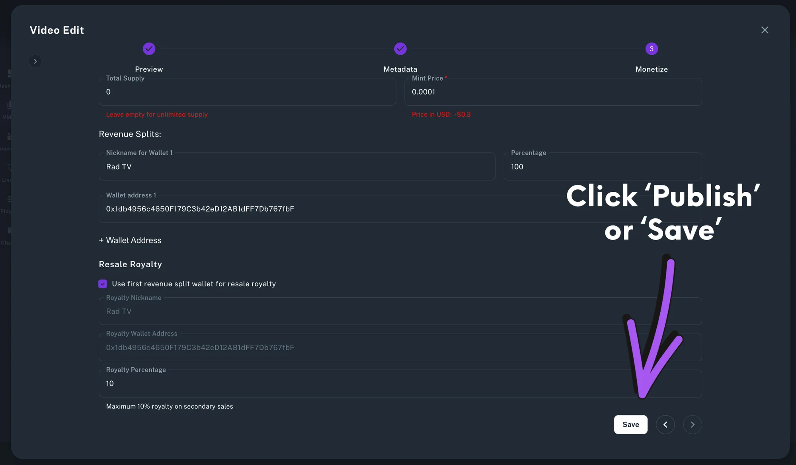

Typically you will see the transaction confirm/reject pop up within a few seconds, but sometimes it can take up to 1 minute. Please be patient as blockchain speeds vary based on many factors.

When the pop up appears inside of your wallet, check to make sure everything looks correct, and click the 'Confirm' button as pictured below 👇

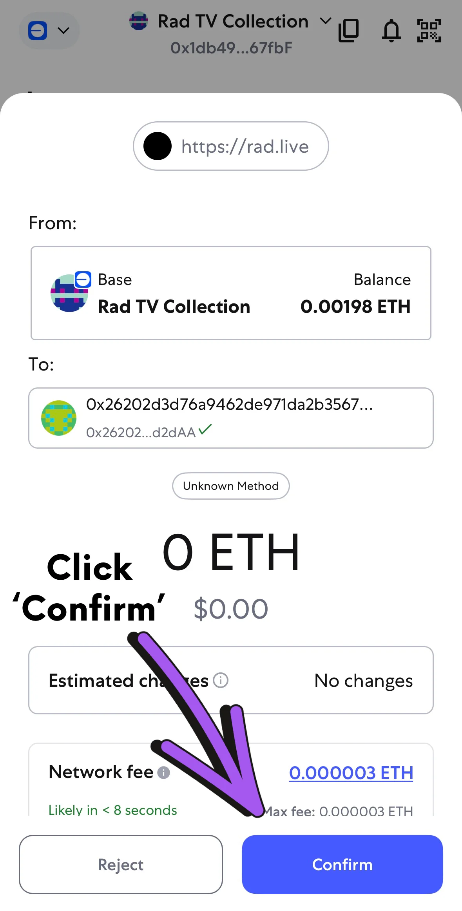

After clicking 'Confirm' you will see the transaction processing and then a transaction complete pop up at the bottom of your mobile and on the monetization page around the same time.

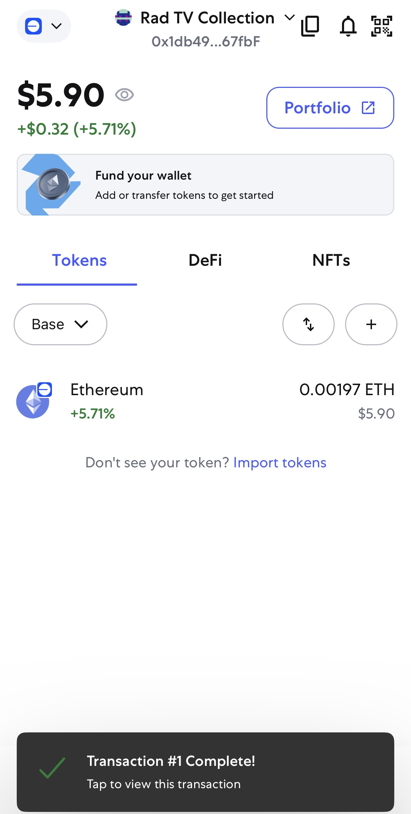

That's it! You have monetized your content on Base and you can begin marketing your content to fans!

Click the X at the top right corner or click out of the Video Edit window to return to your Videos section inside of the Creator Studio. Then click the preview/play button to preview this content on your channel.

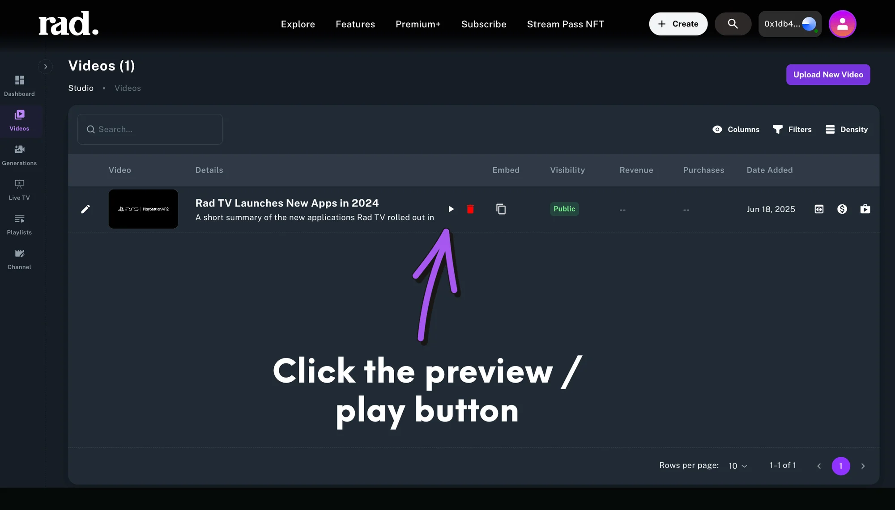

You will be redirected to the content playback page. This URL is where the content lives at RadTV.com.

From this page fans can easily purchase this video as many times as they would like, share the content directly to social media, get an embed code, see price in ETH and USD, watch a short preview, comment, like, and see all video metadata.

