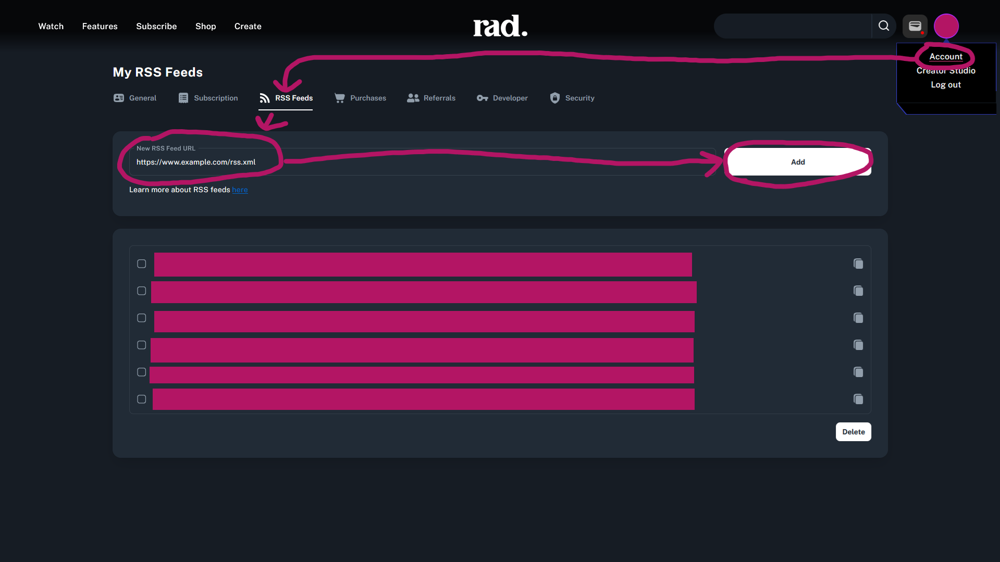

# Adding External RSS Feeds to Your Library

Rad TV allows users to add external RSS feeds to their profile, which can include content from countless existing external video publishers, magazines, news organizations, and beyond.

Since this content is hosted outside of Rad TV, and users are adding the feeds themselves, the content stays private between the user and the original publisher, and the content is not available across Rad TV broadly for discovery.

RSS on Rad TV enables a private viewing environment and a direct relationship with the original publisher, while still leveraging Rad TV's applications for distribution, aggregation, and consumption.

### **How to Add a RSS Feed to Your Rad TV Account**

> [!NOTE]
> RSS Feed URLs must include the proper protocol (http:// or https://)

1. Go the [RSS Feeds page](https://radtv.com/edit-account/?activeTab=rss-feeds) and log into your Rad TV account if you're not already.
2.  Insert the feed URL into the 'Add New Feed URL' field and click the 'Add' button.

    

### **Creating Your Own Feeds**

Please checkout the [Rad TV RSS specification](../getting-started-creators-studios-publishers/publish-rss-from-outside-server.md) to see how to create and host your own Rad TV specific RSS feeds 
