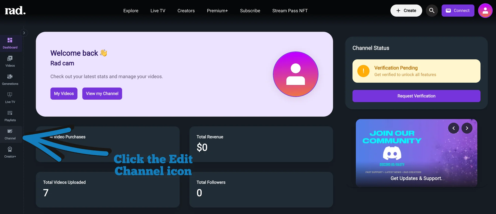
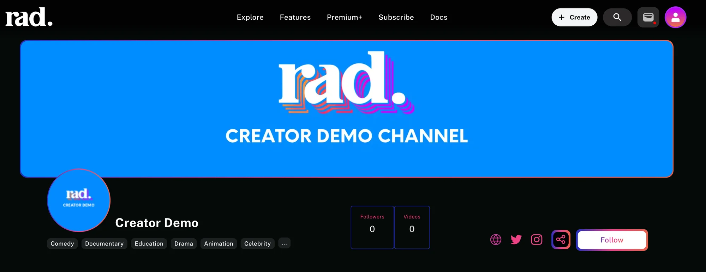
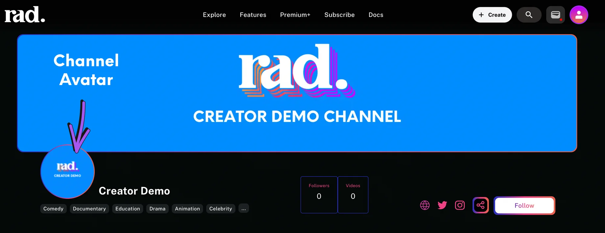
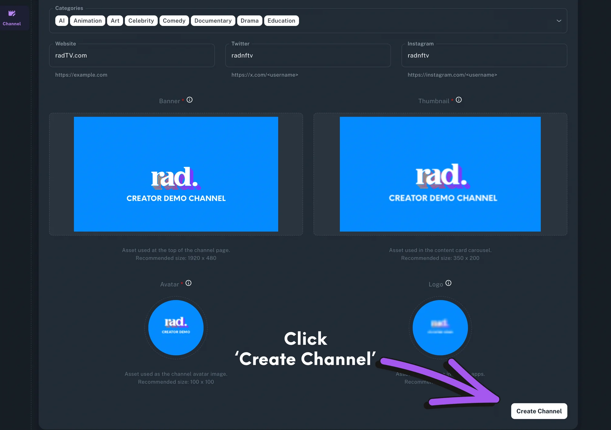
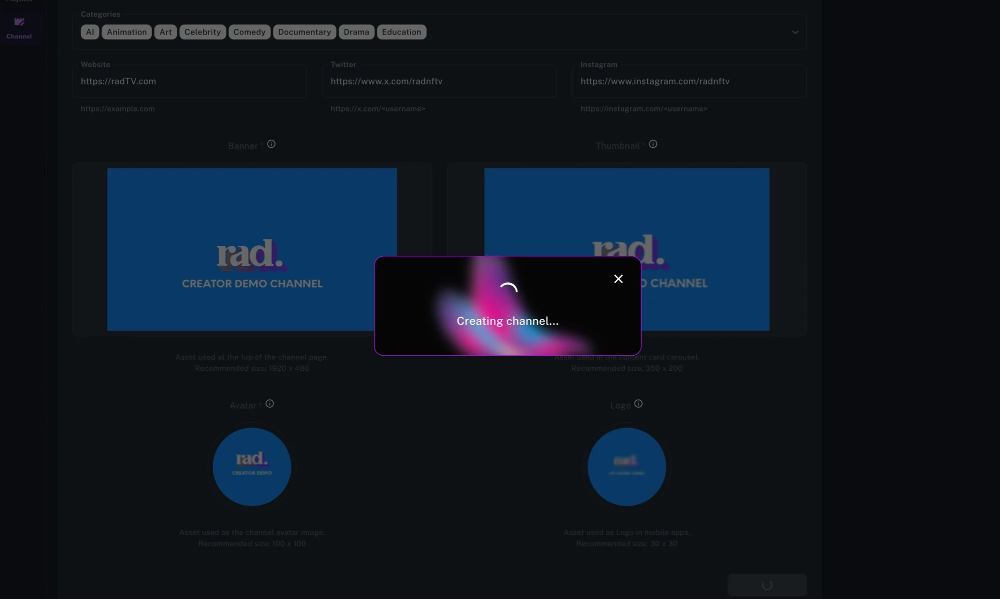
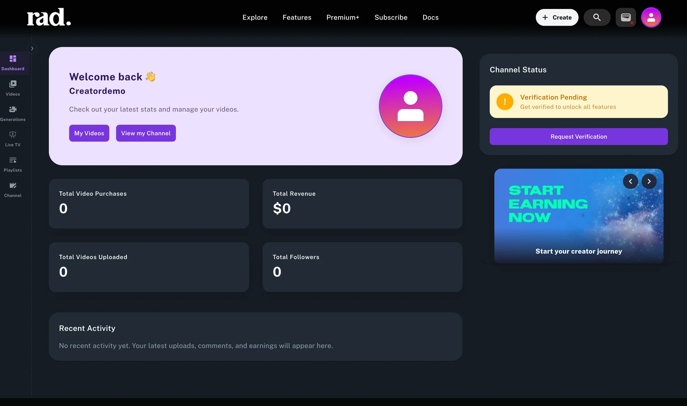

**Branding Your Channel and Publishing Video Content**

A channel is created as soon as you sign up for a free account on Rad TV. Your channel is assigned a random name, that you can [update anytime](https://rad.live/studio/channel/), and you can begin uploading, distributing, and monetizing right away! No approval needed.

To customize your channel head to the [Creator Studio](https://rad.live/studio/) and click the [edit Channel](https://rad.live/studio/channel/) icon as pictured below.

[Click here to watch a step by step video tutorial.](https://rad.live/watch/feature/ab9a2d5f-78b4-4a0f-9739-caf9be39de16/)

Fill in the following fields:

1. Channel Name
2. Channel Summary
   1. Include any associated links in this section
3. Short Summary
4. Categories
5. Website/Social Links
6. Now it’s time to upload your channel's brand assets

   1. Make sure your asset dimensions are JPG, PNG, GIF, or SVG and a max size of 200MB
   2. Upload an image for your Channel Banner: This 1920x1080 image is displayed at the top of your channel and will be the first image viewers will see when they land on your channel

   

   1. Upload an image for your Channel Thumbnail

      1. This image is displayed across the Rad TV ecosystem to represent your channel and can be the same image as your channel banner but you will need to ensure the dimensions are 350x200

      Upload an image for your Channel Avatar

      1. This 100x100 image represents your channel on apps and feeds

      
   2. Upload a 30x30 image for your Channel Logo
      1. This image is shown in our iOS app for channel discovery
7. Click 'Update Channel' at the bottom of the page 👇

Once you click "Update Channel' you will see a pop up pictured below as our system creates your channel

Once this process is complete you will be redirected to your [Creator Studio Dashboard](https://rad.live/studio/) pictured below

From the [Creator Studio Dashboard](https://rad.live/studio/) you are able to easily view your channel, [manage your videos](https://rad.live/studio/videos/) and [playlists](https://rad.live/studio/playlists/), [add Live TV channels](https://rad.live/studio/streams/), access [AI Generative tools](https://rad.live/studio/generations/), and [edit your channel metadata](https://rad.live/studio/channel/).
