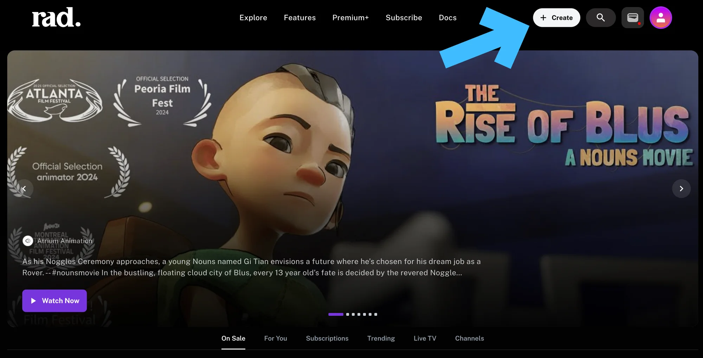
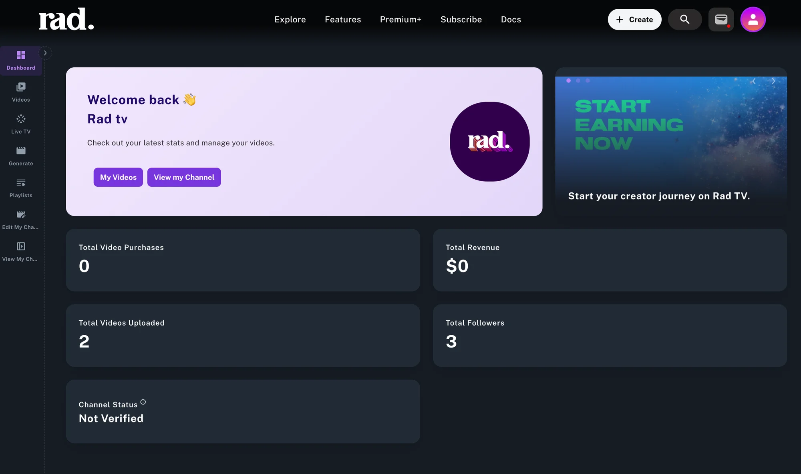
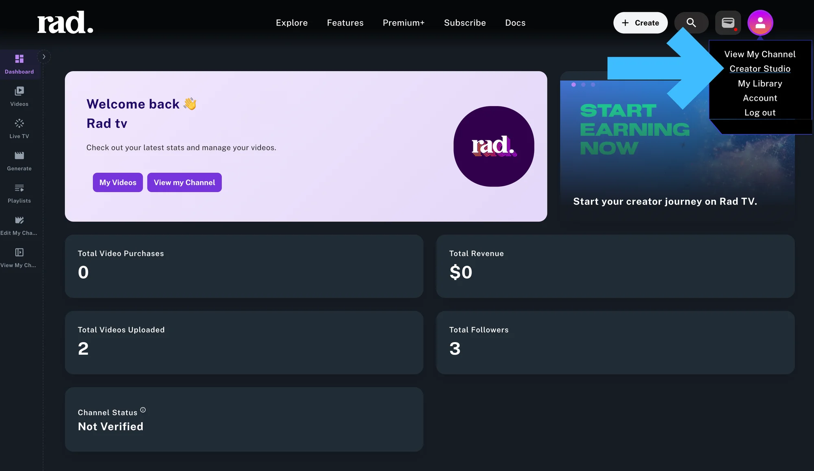
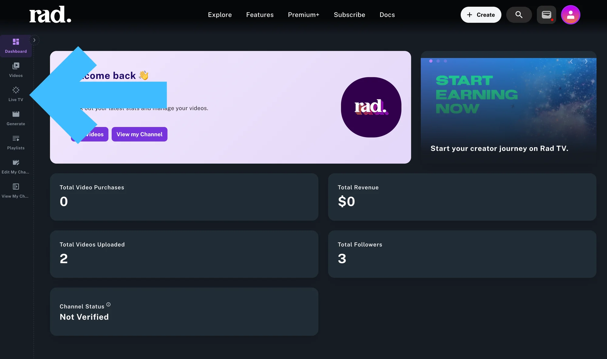
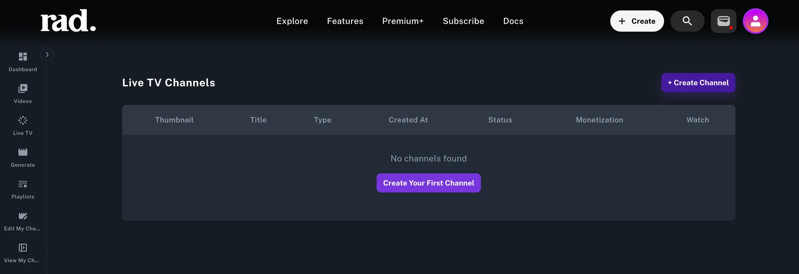
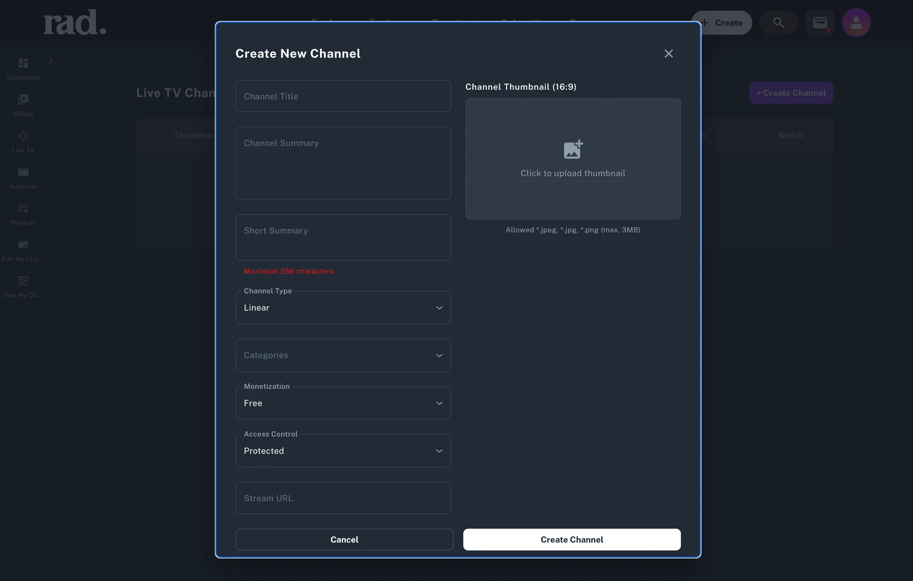
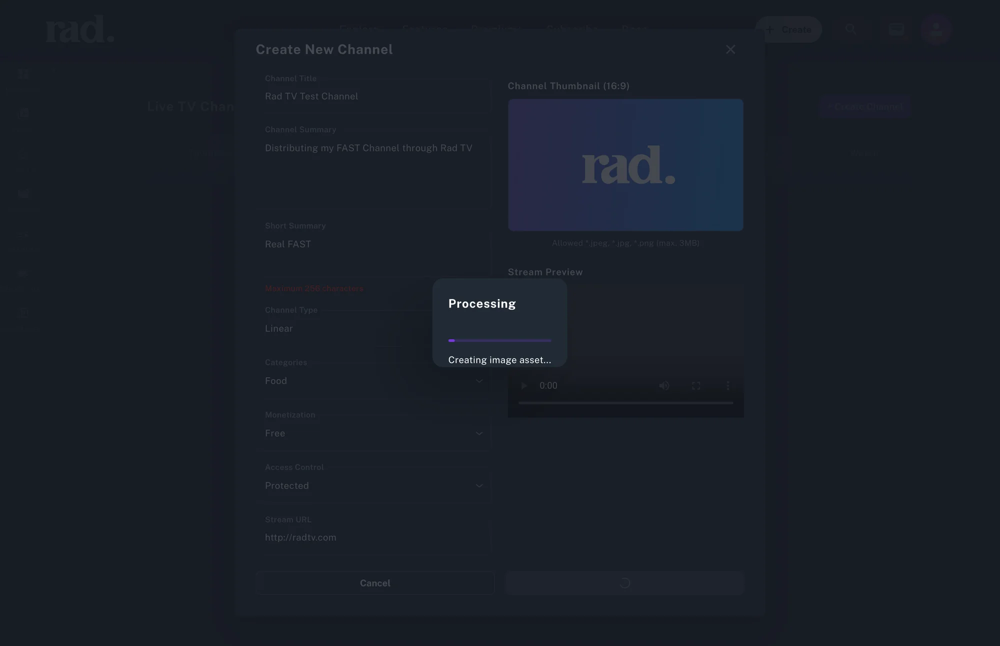
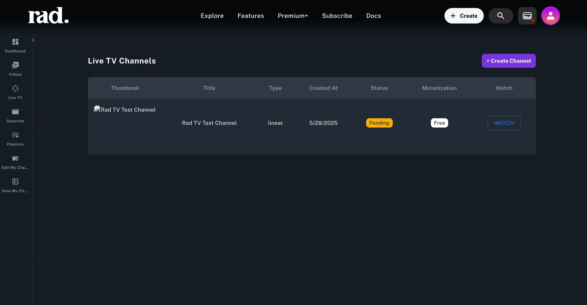

# Distribute Your FAST Channel

**Rad TV has 55+ FAST channels live today with some of the best FAST channel partners in the world.**

If you're a content creator, studio, or content owner that has an existing FAST channel, you can can get started for free at RadTV.com and instantly have your channels live across all of Rad TV's apps.

Watch this [How-To Video](https://rad.live/watch/feature/06e1d6f2-28db-461f-9dc4-df8eff985541/).

## Getting Started

To get started you will need a free account and a creators channel at [RadTV.com](https://radtv.com).

Once you have your free account click the 'Create' button at the top of the page to create your channel.

The Creator Channel you are creating now will serve as your top level branding across the Rad TV ecosystem. This branded channel will be home to all of the content and Live TV Channels you distribute through Rad TV. Of course you can create many channels, but each login can only host 1 channel. Often times, creators have several brands that they work under. Feel free to create as many channels as you need.

Once you are finished with the Channel creation process you will be able to access the Live TV section within your [Creator Studio](https://rad.live/channel/).

You can navigate to your Creator Studio anytime by clicking on your profile pic in the top right hand corner and then selecting Creator Studio as pictured below

Once you are in your Creator Studio you will see Live TV in the left navigation as pictured below

Click 'Create Your First Channel' or '+ Create Channel' to add your FAST channel.

This form allows you to enter your metadata and Stream URL. Once your information looks good and you have uploaded a Channel Thumbnail, click 'Create Channel' at the bottom of the form. You will see your channel creation process is initiated.

After processing is complete, you’ll be redirected to the Live TV section in your Creator Studio, where your new channel will appear with a status of 'Public' or ‘Pending’ depending on if you made your channel public or protected.

At any time you can click on the channel and update metadata or change its status.

If your channel is live you can find it in the [Live TV section](https://rad.live/?tab=live-tv) on the main discovery page or in all Rad TV apps that support Live TV.

And that’s it — your FAST Channel is now distributed to over 6 billion devices worldwide. Yes, _billion_ with a B!

_\*Note: It is important not confuse your Creator Channel with your Live TV channels. A Creator Channel which you will need to create in order to access the Live TV functionality._

Have questions? Reach out via [Discord](https://discord.gg/radtv) or DM us on [𝕏](https://x.com/radnftv).
