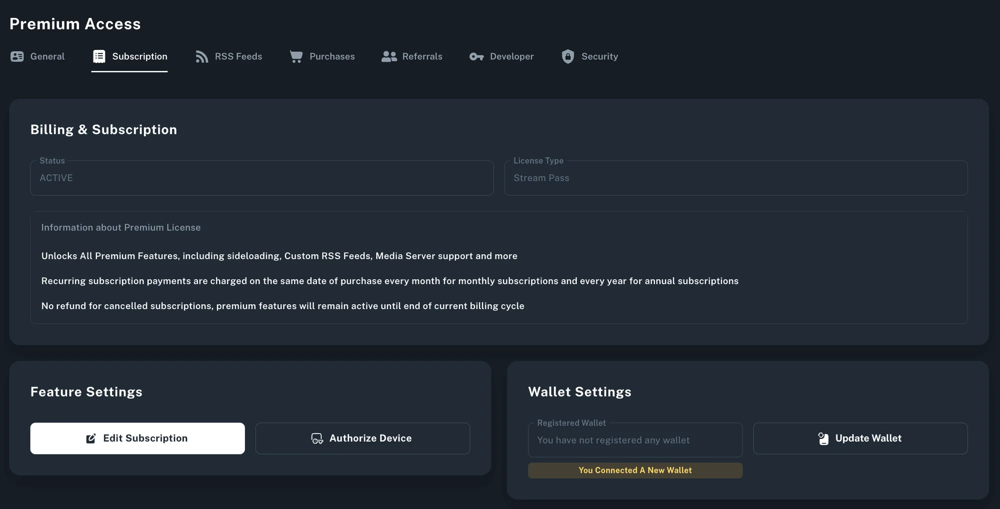

Approved Creators are a step above Verified creators, and meet the necessary criteria to [monetize content by putting it behind the Rad TV Premium Subscription](sell-subscription-video.md)—This allows creators to monetize content on per minutes watched basis.

**To qualify as an Approved Creator, a channel must meet the following requirements:**

1. Your Channel must be Verified on Rad TV, which involves a few simple steps to make sure your channel is fully set up and of high quality. Learn more about how to get [Verified](get-verified.md).
2. You have connected a wallet via the Account Subscription Tab
   1. Click on your profile picture in the top right hand corner at [RadTV.com](https://rad.live/edit-account/) and navigate to the "Account" page > Click on the "Subscription" tab > Click Register or Update Wallet ([Click here for a how-to video](https://rad.live/watch/feature/4042600b-249b-4b08-93e5-194294b6d517/).)

3. Once Verified and you've connected a wallet to your account, fill out this [form](https://bit.ly/RadTV_ApprovedCreator) and our content team will respond via email.
4. Once you're Approved, you can start adding content to the Premium Subscription. Read more [here](sell-subscription-video.md).
