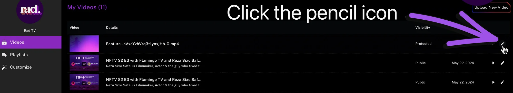
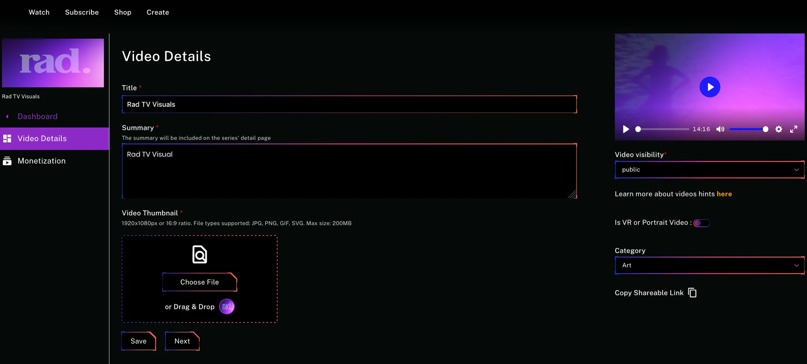
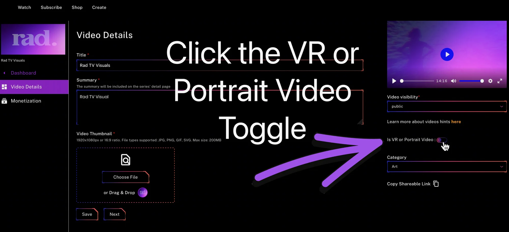
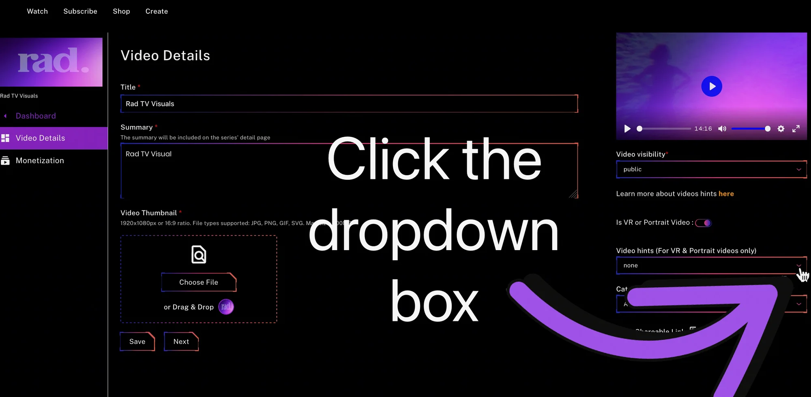
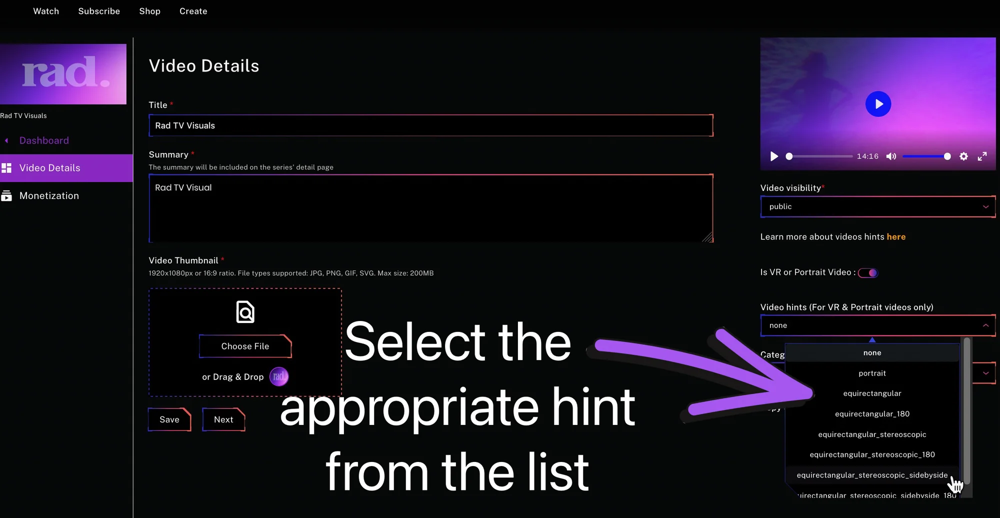
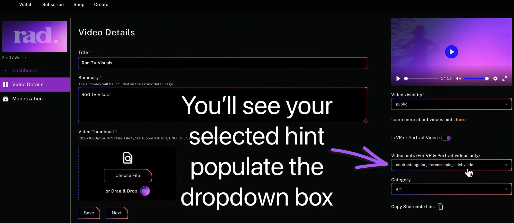
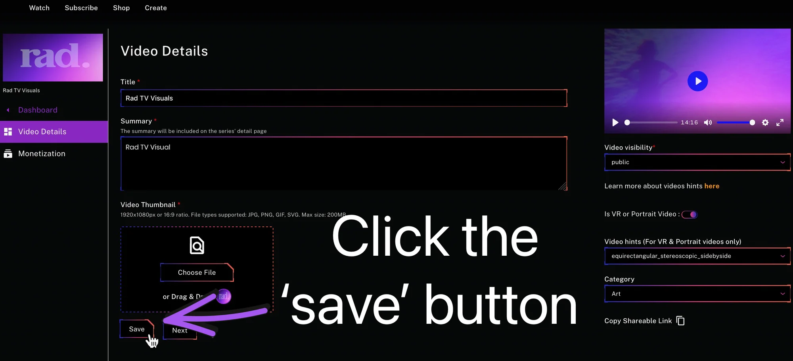

**Creators can now distribute and monetize VR and Portait videos with Rad TV!**

In order for VR and Portrait videos to render correctly creators must assign the appropriate ‘hint’ in the video details. This hint tells us how your content is encoded and ensures that the content is displayed correctly during playback.

Follow these instructions to set the hint for your content:

1. Upload your content ([Learn about uploading content](customizing-your-rad-tv-channel.md))
2. Head to the video details page by clicking the pencil icon associated with your video in your [creator dashboard](https://rad.live/channel/).

3. You will be taken to the Video Details page where you can edit metadata and hints.

4. Enable the VR or Portrait Video hints by clicking on the toggle button pictured below 👇

5. Once enabled a dropdown box will appear. Click the dropdown box to view hints.

6. A list of options will appear. Select the hint that aligns with the content type.

7. Once selected you'll see your selection has populated the box for Video hints.

8. When everything looks good click the save button.

You’re all set! Now check the playback on your favorite device to ensure you selected the correct hint. If you are unsure which hint is best or if the content is not displaying correctly try selecting a different hint.

If you continue to experience issues with your content playback after trying all available hints feel free to contact us at support@rad.live.

**Hint Types:**

1. Equirectangular (2D 360° video): A video format that covers the entire 360° sphere in 2D, allowing the viewer to look all the way around.
2. Equirectangular 180 (2D 180° video): A video format that covers 180° in 2D, showing half the sphere; the back half is black.
3. Equirectangular Stereoscopic (3D 360° video): A 3D video format that covers the entire 360° sphere, providing depth perception all the way around.
4. Equirectangular Stereoscopic 180 (3D 180° video): A 3D video format that covers 180°, providing depth perception in the front half, with the back half black.
5. Equirectangular Stereoscopic Side by Side (3D 360° SBS video): A 3D video format covering the full 360° sphere, displayed in a side-by-side format for stereoscopic viewing.
6. Equirectangular Stereoscopic Side by Side 180 (3D 180° SBS video): A 3D video format covering 180°, displayed in a side-by-side format for stereoscopic viewing, with the back half black.
