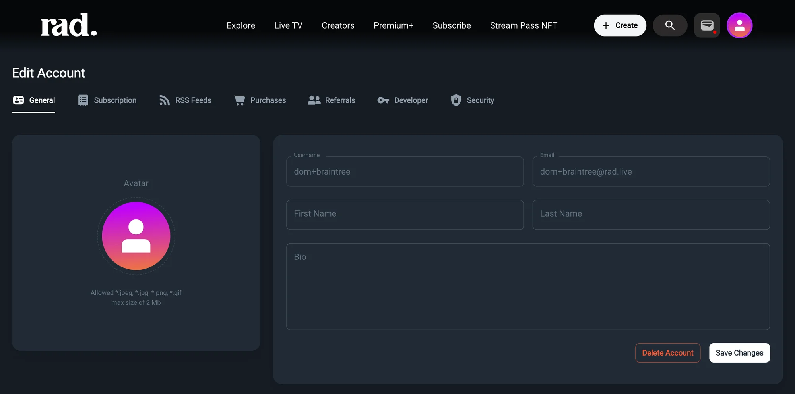
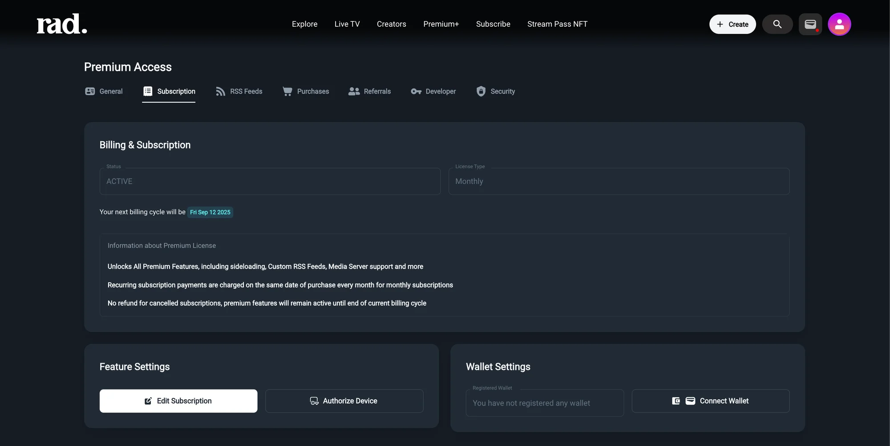
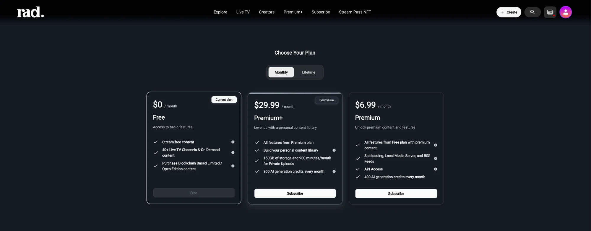
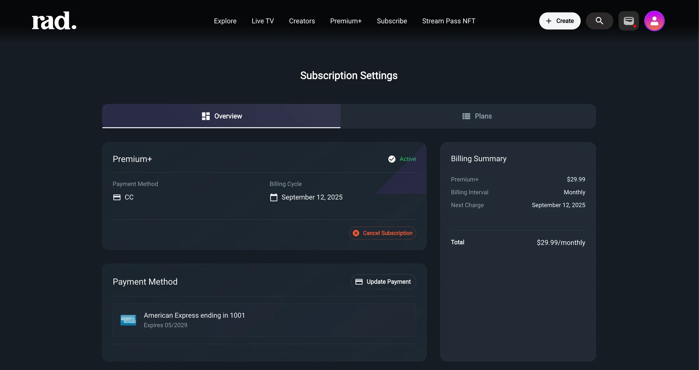
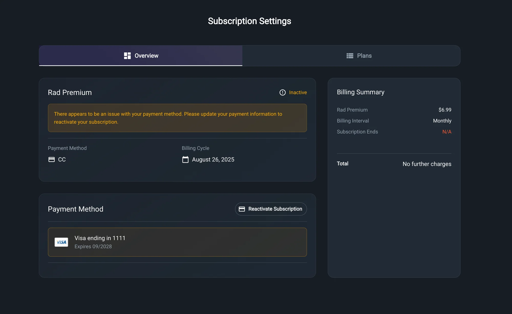
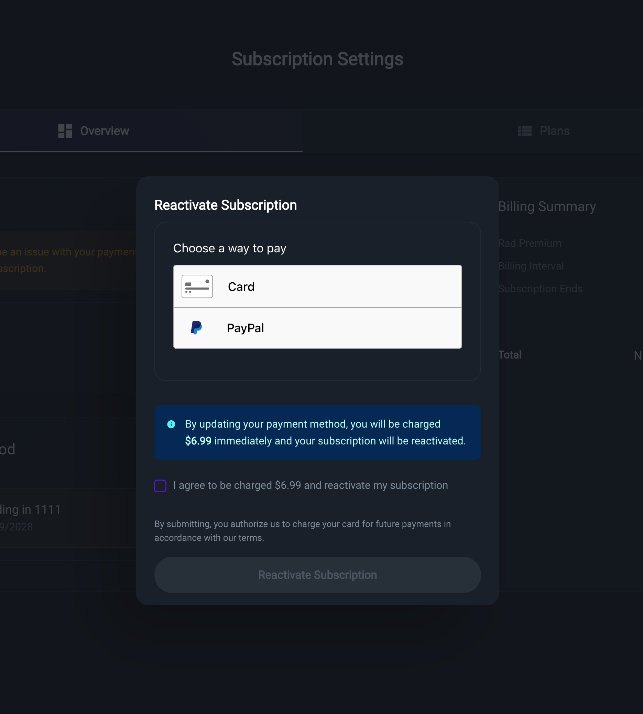
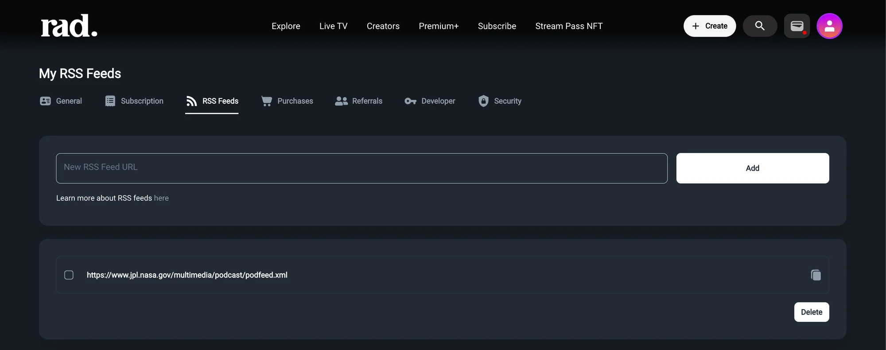
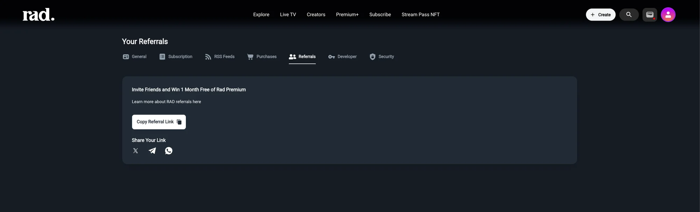
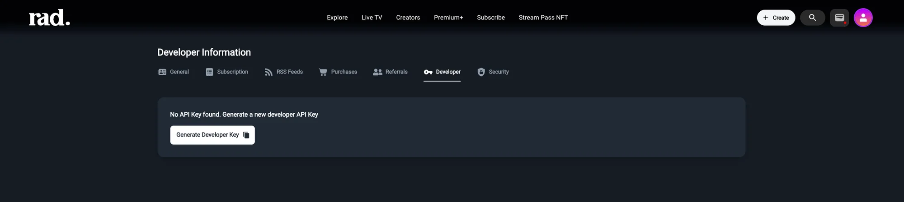
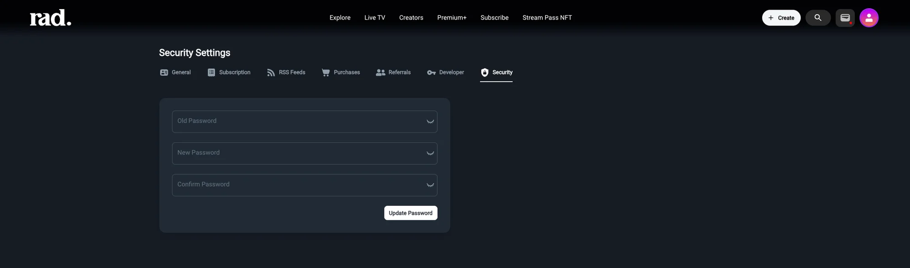

# Account Management

### General Account Settings

The `General` tab is where you manage your core profile information.

* **Avatar**: Click on the circular icon to upload a new profile picture. Allowed file types are `.jpg`, `.png`, and `.gif`, with a maximum size of 2MB.
* **Username**: Your unique identifier on Rad TV.
* **Email**: The email address associated with your account, used for login and communications.
* **First Name & Last Name**: Add your name to personalize your account.
* **Bio**: Write a short description about yourself that others can see on your profile.
* **Save Changes**: After making any changes on this page, be sure to click this button to save them.
* **Delete Account**: This button will permanently delete your Rad TV account and all associated data. This action cannot be undone.

***

### Subscription

The `Subscription` tab is your hub for managing your Rad premium access plan.

#### Your Premium Access

If you have an active subscription, this page gives you a summary of its status and features.

* **Billing & Subscription**: This section shows your subscription `Status` (e.g., ACTIVE), `License Type` (e.g., Monthly), and your next billing date.
* **Information about Premium License**: Here you can read about the features included in your subscription, such as access to all premium content, custom RSS Feeds, and more.
* **Feature Settings**:
  * **Edit Subscription**: Click here to go to the detailed billing and payment management page.
  * **Authorize Device**: Manage the devices that are authorized to use your account.

#### Choosing or Changing Your Plan

If you don't have a subscription or wish to change your current one, you'll see the plan selection screen.

* **Monthly / Lifetime**: Toggle between different billing frequencies.
* **Plan Tiers**: Compare the features of different plans like `Free`, `Premium+`, and `Premium`. Each card details the specific features you get, such as content access, storage, and AI generation credits.
* **Subscribe**: Click the "Subscribe" button under the plan you want to choose.

#### Billing & Payment Method

By clicking "Edit Subscription," you are taken to a detailed view of your billing information.

* **Overview / Plans**: Navigate between your subscription summary and the available plans.
* **Billing Summary**: A clear breakdown of your current plan, billing interval, next charge date, and the total monthly cost.
* **Payment Method**: Displays the current payment method on file (e.g., American Express ending in 1001).
  * **Update Payment**: Click this to change or update your credit card information.
* **Cancel Subscription**: Use this link to stop your subscription from renewing at the end of the current billing cycle.

#### Payment Issues

If there has been an issue with charging your payment method you will see an error message. Clicking on the Reactivate Subscription button will open a window where you can enter a new payment method.

After a new payment method has been entered and confirmed your subscription will be reactivated and that new payment method will be charged going forward.

***

### RSS Feeds

This powerful feature allows you to add your own content to Rad TV via RSS feeds.

* **New RSS Feed URL**: Paste the URL of a valid RSS feed into this field and click **Add** to import it.
* **Feed List**: Below the input box, you will see a list of all the RSS feeds you have successfully added.
* **Delete**: To remove a feed, check the box next to it and click the **Delete** button.

***

### Referrals

Earn rewards by sharing Rad TV with your friends.

* **Invite Friends and Win**: The current referral offer is displayed here (e.g., Win 1 Month Free of Rad Premium).
* **Copy Referral Link**: Click this button to copy your unique referral link to your clipboard.
* **Share Your Link**: Use the social media icons (e.g., X, Telegram, WhatsApp) to quickly share your link directly with friends.

***

### Developers

For technically-inclined users who want to build applications using Rad TV's API.

* **API Key**: An API (Application Programming Interface) key allows other applications to interact with Rad TV's services securely. If you are a developer, you can generate a key here to use in your projects.
* **Generate Developer API Key**: If you don't have a key, click this button to create one.

***

### Security Settings

Keep your account secure by managing your password.

To change your password, follow these steps:

1. Enter your current password in the **Old Password** field.
2. Enter your new, secure password in the **New Password** field.
3. Confirm the new password by typing it again in the **Confirm Password** field.
4. Click **Update Password** to save the change.
