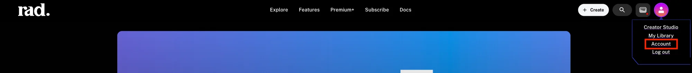
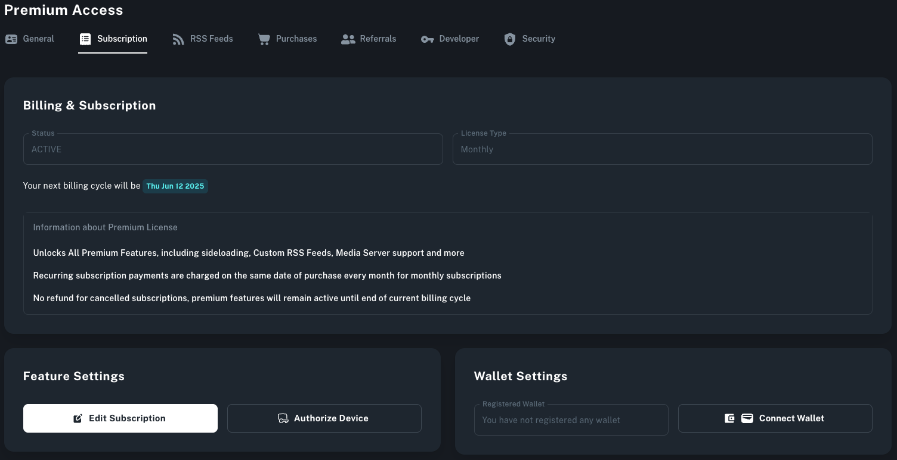
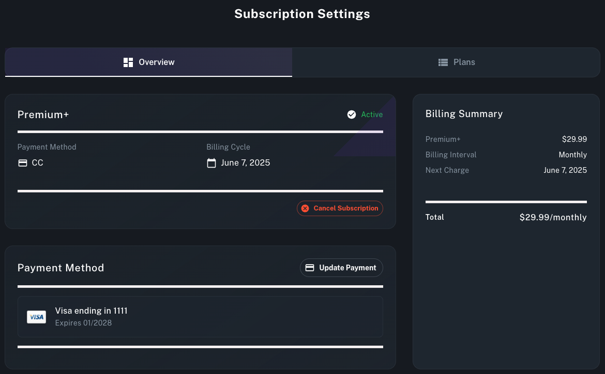
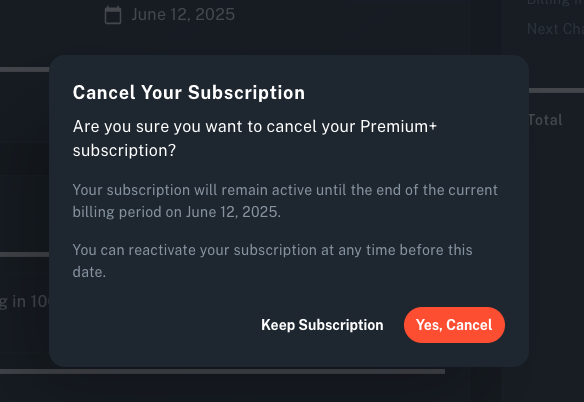

Your subscription state and status can always be viewed from your account page.

Clicking the Edit Subscription button takes you to your billing details.

On this page you can see all of the current information about your subscription. Clicking on the Cancel Subscription button will cancel your subscription. It will remain active until the end of your current billing cycle. You will see a final confirmation dialog window confirming that you do indeed want to cancel.

After completing these steps your subscription will be cancelled. If you experience any issues please [contact support](/docs/rad-tv-technical-support/) for further assistance.
