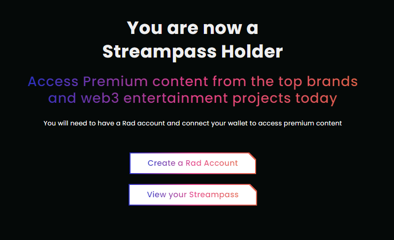
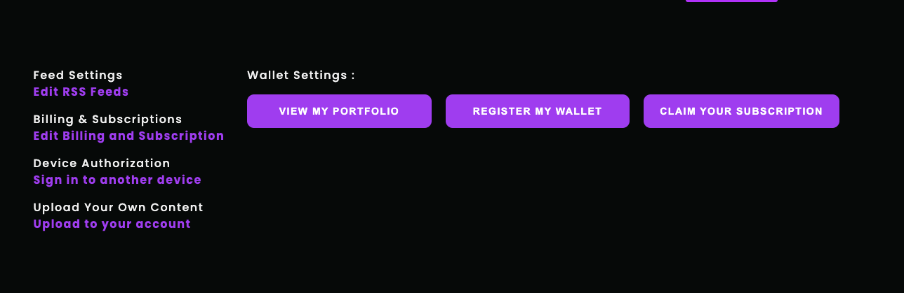
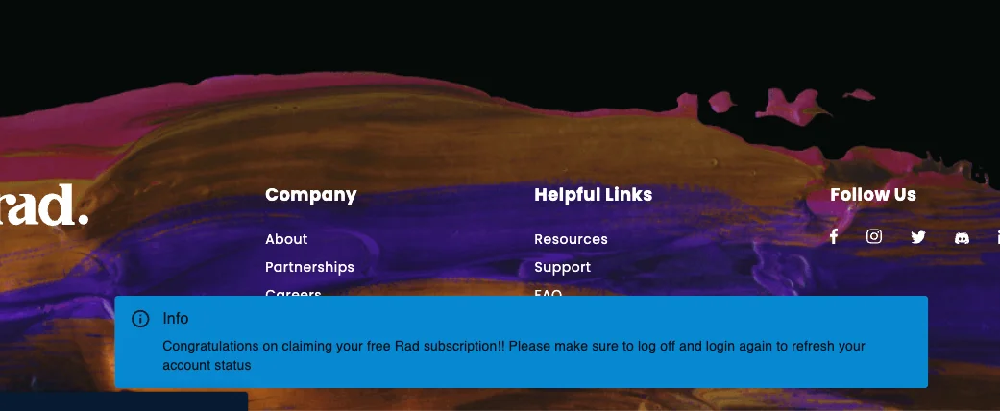
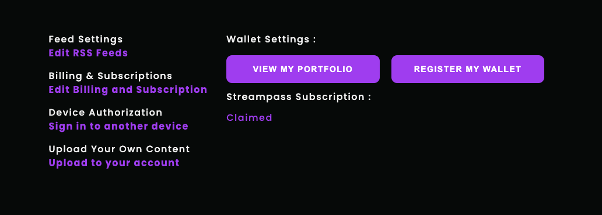

# Unlock Rad TV Premium with a Stream Pass NFT

## Mint a Stream Pass NFT

* **Step 1:** Visit the official Stream Pass Minting Page here - [https://rad.live/streampass](https://rad.live/streampass)
* **Step 2:** Connect your Web3 Wallet through MetaMask or WalletConnect and hold enough ETH\
  \
  Public Sale Price: .025 ETH (+ Gas Fees; check gas fees in our discord server bot commands channel, _subject to change_)
* **Step 3:** Select the number of Stream Passes you would like to purchase and Click “Mint your Stream Pass” and go through the transaction approvals in your wallet.\
  If you have any questions or need help with minting, feel free to message in our [discord](https://discord.gg/radnftv).
* **Step 4:** On a successful mint, you should see the following page

## How to claim Access to Rad TV Premium Streaming Features with a Stream Pass

Now you are a proud holder of our Stream Pass NFT. You can enjoy all the features that come with it!

* **Step 5 :** In order to unlock access you need a Rad TV account. You can create one by going to [https://rad.live/signup](https://rad.live/signup). If you already have an account, you can login here - [https://rad.live/login](https://rad.live/login)
* **Step 6 :** Navigate to your account settings page and connect your wallet if you haven’t already. Once connected, if your wallet holds our Stream Pass NFT your account settings page will look like this

* **Step 8 :** Click the “Claim your Subscription” button and you should see a pop-up confirming your subscription

* **Step 9 :** Once you have claimed your subscription, your account settings page should reflect your Stream Pass subscription status as “Claimed”. Now you have access enabled on Web and all of our client applications (PlayStation 4 and 5 consoles, PlayStation VR and VR2, Quest, iOS, Apple Vision Pro, Apple TV, Chromecast, Android Mobile, Android TV, Amazon Fire.)

 
